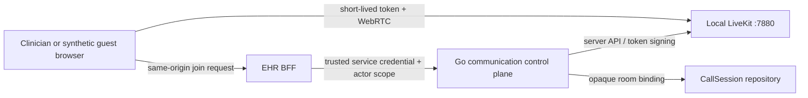

# Architecture � telehealth-browser-media

**Status:** Approved for local-only implementation
**PRD:** `../definition/prd.md`
**Review:** Winston architecture; Alex FHIR non-impact review recorded in `../definition/fhir-data-contract.md`.

## Decision

Use a local LiveKit SFU with the existing Go `communication` service as the only token signer. The browser calls the existing EHR BFF; the BFF sends trusted actor context to Go; Go authorizes the actor against CallSession participants and mints a five-minute scoped token for an opaque room/identity. The browser uses `livekit-client` to connect directly to LiveKit over WebRTC.

## Boundaries

| Layer | Responsibility | Must not do |
|---|---|---|
| EHR BFF | Resolve session/preview actor, proxy token request, map problems | Sign tokens or expose control-plane credential |
| Go control plane | Authorize, look up CallSession, mint scoped token | Treat token issuance as ACTIVE or store media streams |
| LiveKit | WebRTC signaling/media/tracks | Authorize clinical access or own call history |
| Browser meeting | User-consented media controls and actual connection display | Read secrets, authorise itself, or mutate clinical lifecycle |

## Configuration

Local live mode requires `CALL_PROVIDER_MODE=live`, `CALL_PROVIDER=livekit`, `CALL_PROVIDER_BASE_URL=http://127.0.0.1:7880`, `CALL_PROVIDER_API_KEY=devkey`, `CALL_PROVIDER_API_SECRET=secret`, `COMMUNICATION_SERVICE_AUTH_TOKEN`, and EHR `COMMUNICATION_SERVICE_URL`. These values are development-only and never committed in `.env` files.

## Local server

Install the official Windows `livekit-server` release, then run `livekit-server --dev`. The service binds `127.0.0.1:7880` and uses only the documented non-production key pair. Docker is optional and absent from the current machine.

## Security

- Token TTL is five minutes; grant only room join, publish, subscribe, and the authorized opaque identity.
- Tokens are returned in a JSON response body and remain in component memory only.
- Room ID, identity, correlation ID, and logs contain no name, MRN, diagnosis, or media content.
- Invalid call, foreign actor, or unavailable LiveKit returns `application/problem+json`.
- Media joins are local developer evidence only; signed provider webhooks and durable production state reconciliation remain future gates.

## Gate G4 status

[x] Architecture, API contract, security, and FHIR non-impact boundaries defined.
[x] Local server runtime decision documented.
[x] Local SFU installed and two participants joined the same opaque room.
[x] Alex approved the no-FHIR-projection decision; Jordan approved the server-only BFF/browser boundary.
[ ] Human device permission and published camera/microphone-track evidence.
