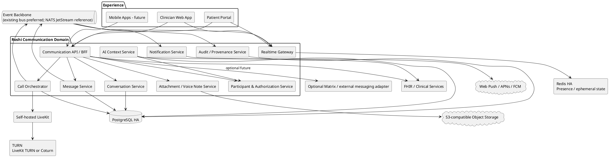
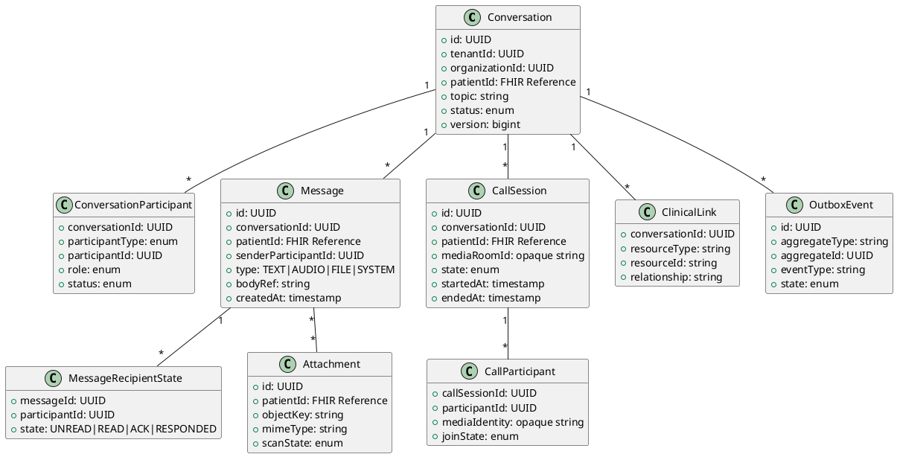
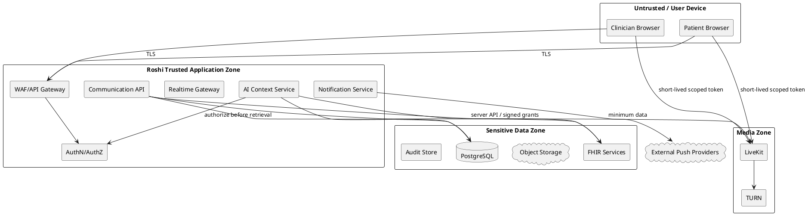
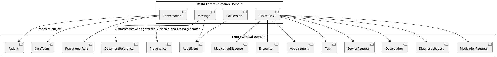
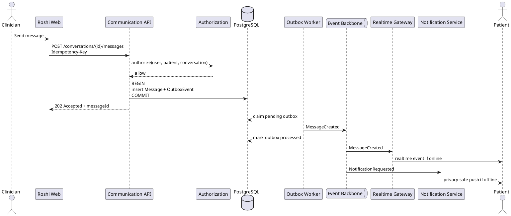
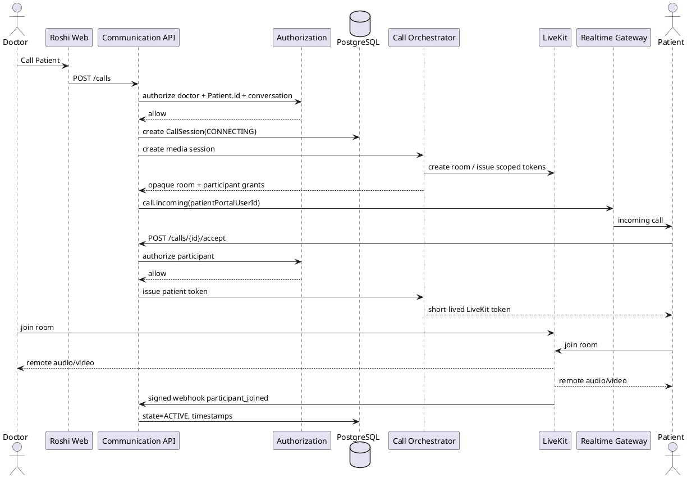

# Roshi Communication Platform - Solution Architecture

**Status:** Legacy target-state diagram reference
**Canonical architecture:** [HLD.md](HLD.md) and [LLD.md](LLD.md)

The diagrams below illustrate the desired production architecture. They do not describe the active EHR-local Communication Hub, which currently runs in the Next.js EHR process with file-backed development state, in-process SSE, unavailable external providers, and no wired FHIR communication mapper. The adjacent DOCX is a historical export and must be regenerated before it is used as a current specification.

## Target-state PlantUML diagrams

### 03_logical_architecture.puml


### 08_data_model.puml


### 11_security_trust_boundaries.puml


### 15_fhir_integration.puml


### 05_message_sequence.puml


### 06_call_sequence.puml


### 04_deployment_topology.puml
```plantuml
@startuml
node "Canadian Region / Approved Data Residency" {
  node "Edge" {
    [WAF / API LB]
    [Media LB / DNS]
  }
  node "Application Kubernetes Cluster" {
    [Communication API xN]
    [Realtime Gateway xN]
    [Workers xN]
    [Notification Service xN]
    [AI Context Service xN]
  }
  node "Dedicated Media Node Pool" {
    [LiveKit Node A]
    [LiveKit Node B]
    [LiveKit Node C]
  }
  node "TURN Failure Domain A" { [TURN A] }
  node "TURN Failure Domain B" { [TURN B] }
  database "PostgreSQL HA" as PG
  database "Redis HA" as REDIS
  queue "Event Backbone HA" as BUS
  cloud "Object Storage" as OBJ
  node "Observability" {
    [Metrics]
    [Logs]
    [Tracing]
    [Synthetic Call Tests]
  }
}
[WAF / API LB] --> [Communication API xN]
[WAF / API LB] --> [Realtime Gateway xN]
[Communication API xN] --> PG
[Communication API xN] --> BUS
[Realtime Gateway xN] --> REDIS
[Workers xN] --> BUS
[Workers xN] --> PG
[Workers xN] --> OBJ
[Media LB / DNS] --> [LiveKit Node A]
[Media LB / DNS] --> [LiveKit Node B]
[Media LB / DNS] --> [LiveKit Node C]
[LiveKit Node A] --> REDIS
[LiveKit Node B] --> REDIS
[LiveKit Node C] --> REDIS
[LiveKit Node A] --> [TURN A]
[LiveKit Node B] --> [TURN B]
@enduml
```
