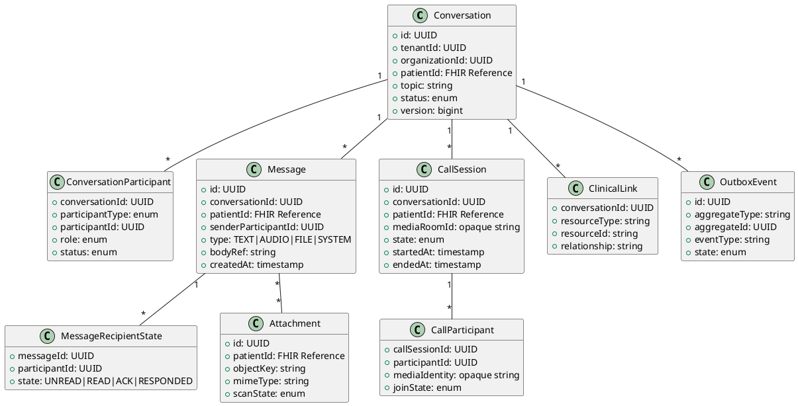
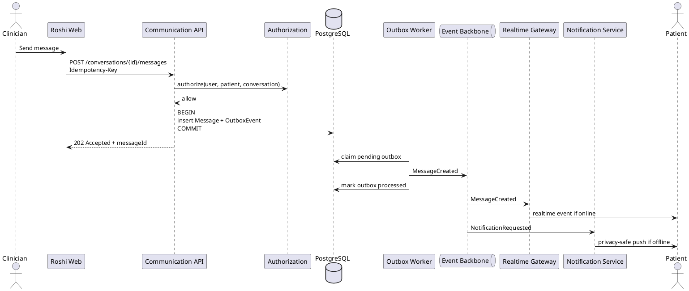
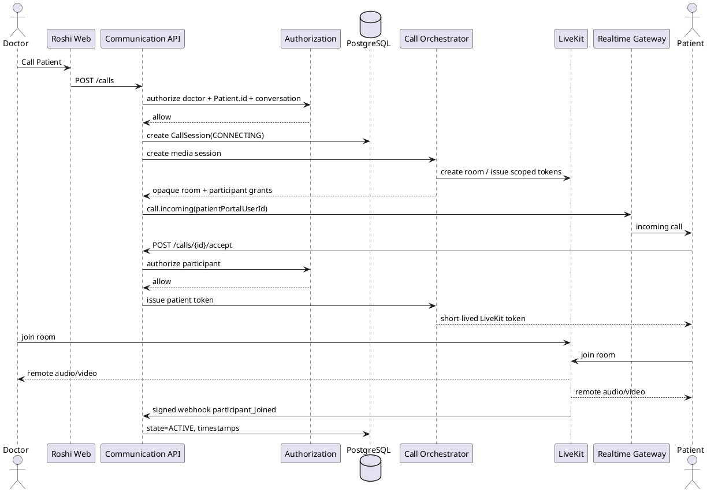
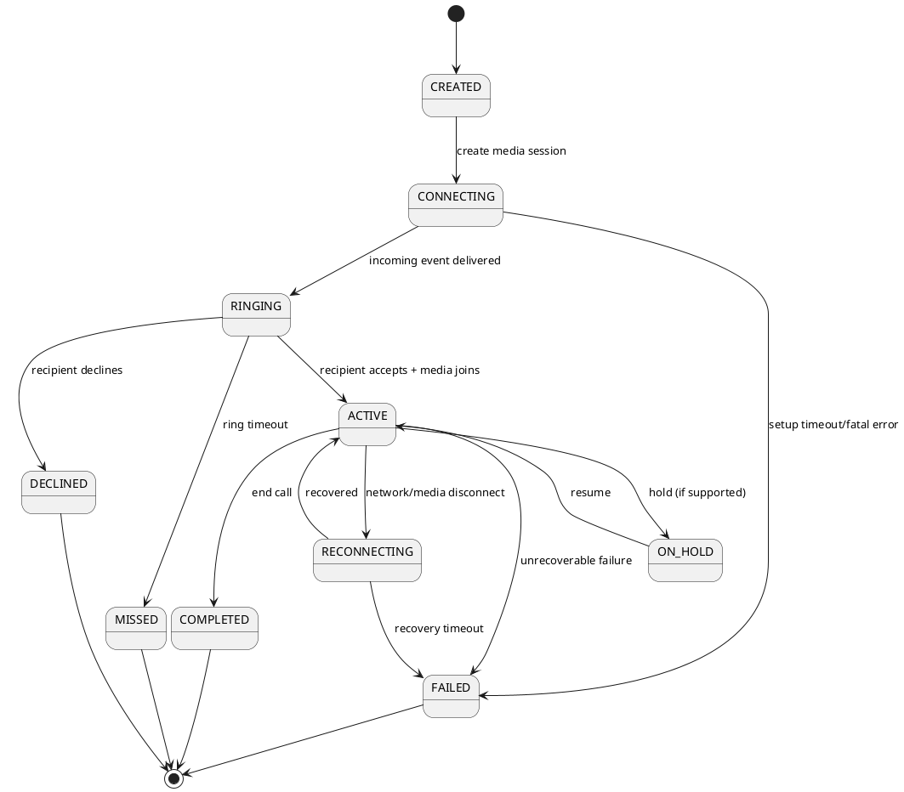
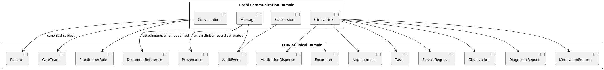
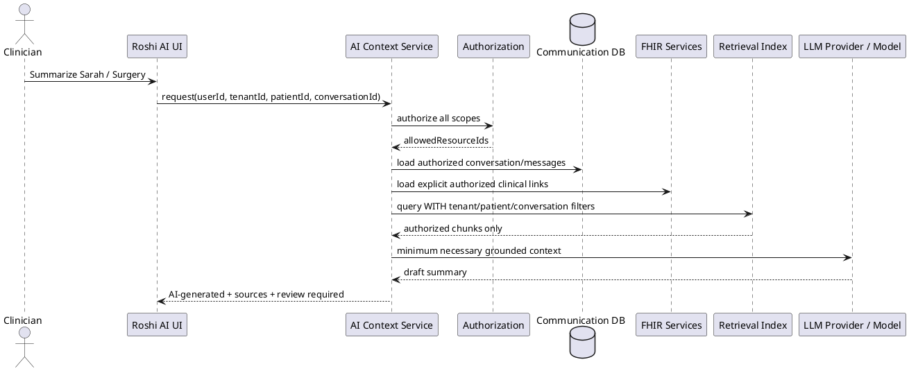

# Roshi Communication Platform - Low-Level Design

**Status:** Legacy target-state diagram reference
**Canonical LLD:** [LLD.md](LLD.md)

The diagrams below describe the target production architecture only. For current EHR-local code ownership, the extraction boundary, API contracts, FHIR mapping controls, and production gates, use the canonical LLD. The adjacent DOCX is a historical export and must be regenerated before it is used as a current specification.

## Target-state PlantUML diagrams

### 08_data_model.puml

### 05_message_sequence.puml

### 06_call_sequence.puml

### 09_call_state_machine.puml

### 15_fhir_integration.puml

### 12_ai_authorization_flow.puml

