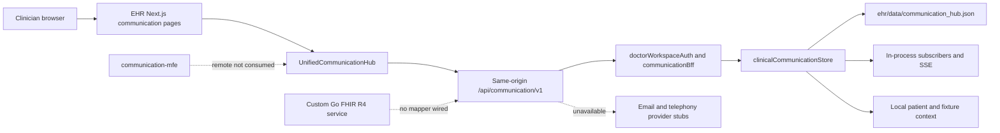
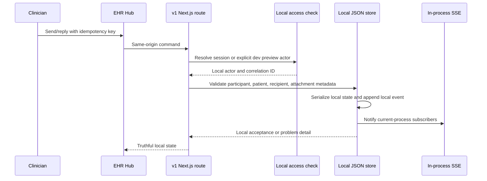
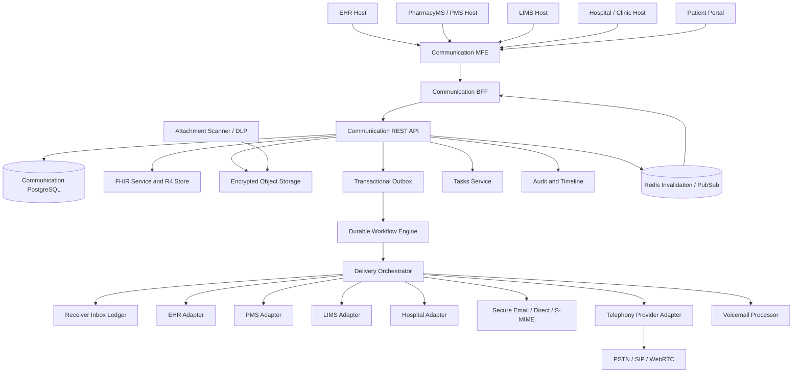
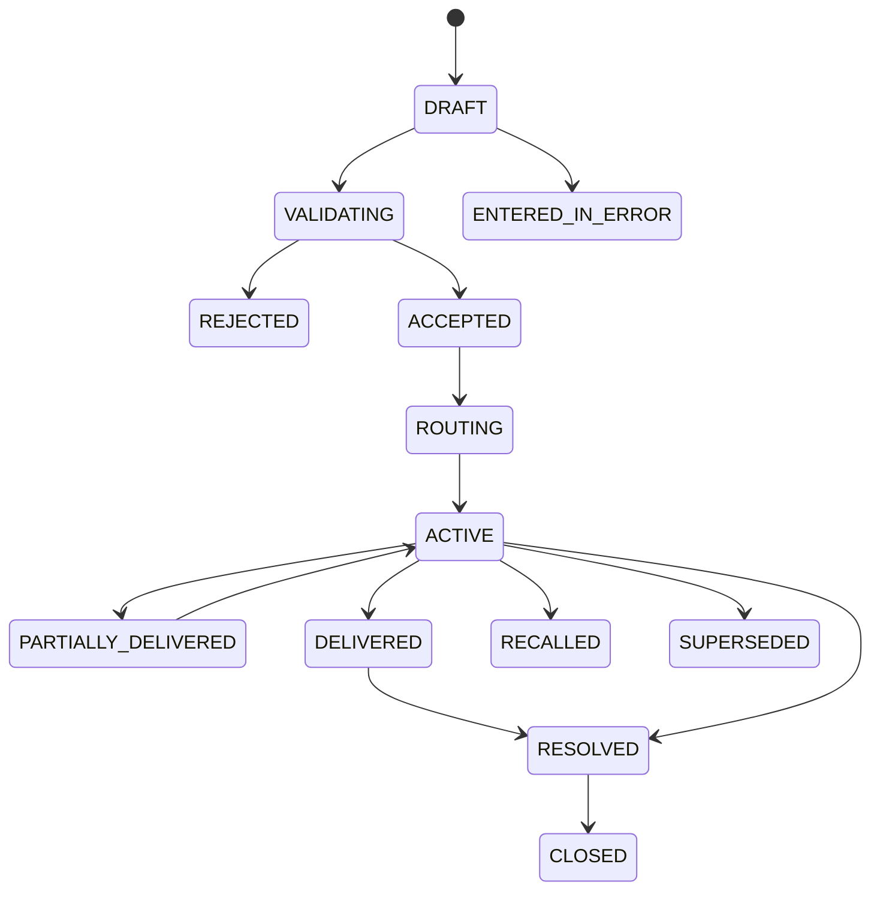
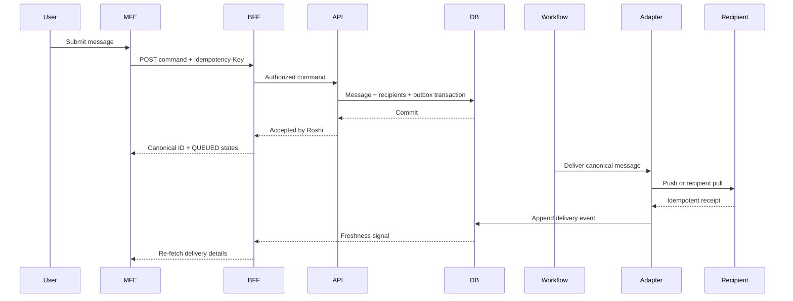

# Roshi Unified Clinical Communication Platform - High-Level Design

**Status:** Revised implementation-aligned design
**Revision date:** 2026-09-14
**Scope:** EHR Communication Hub local mode and the gated production target for EHR, PharmacyMS/PMS, LIMS, hospital, care team, patient portal, messaging, calls, voicemail, tasks, timeline, attachments, and optional AI assistance.
**FHIR baseline:** The workspace defaults to FHIR R4. Ontario, partner, profile, terminology, and transport details remain unconfirmed production prerequisites.
**Jurisdiction:** Ontario, Canada is the target deployment context. This document does not claim Ontario Health, PHIPA, data residency, or partner approval.

## 1. Purpose and reading convention

Roshi needs one longitudinal clinical communication experience. Email, secure messages, calls, voicemail, tasks, delivery events, acknowledgements, and follow-up actions should be represented as related channel records in a shared conversation rather than unrelated applications.

This document distinguishes two states:

- **Current local implementation** is the EHR-hosted Next.js workflow described immediately below. It uses synthetic development data and must not be represented as an external delivery or production service.
- **Target architecture** begins at Section 2. It is the approved direction, subject to the release gates in the PRD. It is not a description of deployed infrastructure unless a section explicitly says otherwise.

### Target design principles

- One canonical conversation can contain multiple channels.
- A patient-linked clinical conversation belongs to one patient.
- Submitted message content is immutable; corrections create linked messages.
- Communication state, delivery state, read state, acknowledgement state, and action state are separate.
- FHIR represents clinical interoperability; it is not the guaranteed-delivery broker.
- Accepted messages are durably persisted before acceptance is returned.
- Delivery is at-least-once with idempotent receivers, retries, fallback, and replay.
- A fallback channel never erases pending primary delivery.
- Manual confirmation records an additional fact and never rewrites machine delivery history.
- No channel is marked complete from a weaker signal than it actually provides.
- Clinical actions require explicit authorization and human confirmation.
- Every visible production control has a real command, a useful state, and an auditable outcome.

## Current local implementation

### Runtime topology

| Concern | Current implementation | Boundary/limit |
|---|---|---|
| Hub UI | EHR routes under `ehr/src/app/communication/` render the Unified Communication Hub, including synthetic messages, calls, voicemail, drafts, timeline, delivery, and context records. | It is not yet a shared host-consumed MFE. |
| Browser API | Next.js routes under `/api/communication/v1` use `communicationBff.ts` for correlation IDs, structured envelopes, problem details, and local actor resolution. | The BFF runs inside the EHR process; no standalone BFF or Go communication service exists. |
| State | `clinicalCommunicationStore.ts` serializes local development data to `ehr/data/communication_hub.json`. | It is not a transactional, multi-instance, tenant-isolated communication database or durable workflow ledger. |
| Authorization | Normal session checks apply, and an explicit `asUser=dev` alias resolves a local preview clinician. Reads/mutations and SSE delivery are restricted to conversation participants. | Tenant, organization, circle-of-care, proxy, consent, recording, retention, and cross-organization policy are not implemented. |
| Commands | Local drafts, replies, internal notes, acknowledgement records, task records, attachment metadata, and idempotency checks exist. | Local acceptance or queued state is not evidence of external delivery; tasks are not canonical task-service records. |
| Attachments | Server-issued metadata IDs are actor-, patient-, expiry-, and single-use-bound before submission. | No binary upload, content verification, malware/DLP scan, object storage, or durable scan lifecycle exists. |
| Calls/voicemail | Fixture/local call and voicemail records are visible; a call command reports an unavailable provider. | No LiveKit, TURN, PSTN/SIP, recording, transcription, or provider webhook is configured. |
| Realtime | Participant-filtered SSE is backed by in-process subscribers. | There is no event backbone, cross-process fan-out, durable replay cursor, or recovery worker. |
| MFE | `communication-mfe` builds Module Federation entries and a host contract. | The EHR does not load its `remoteEntry.js` or mount the remote. |
| FHIR/audit | A custom Go FHIR R4 service and EHR audit helper exist separately. | No communication mapper, profile validation, canonical task integration, or complete communication audit integration is wired. |
| Deployment | Local EHR/service scripts can run development services. | There is no communication-specific container, migration, CI/CD workflow, secret configuration, or remote deployment evidence. |

### Current local message flow

This flow has no PostgreSQL transaction, outbox, worker, provider call, FHIR projection, canonical task creation, or durable audit write.

## 2. Target product boundaries

### In scope

- Global Communication Hub with Inbox, Sent, Drafts, Awaiting Response, Needs Action, Urgent, Calls, Voicemail, Delivery Issues, Archived, and Timeline modes.
- Secure messages and email threads with rich composition, multiple recipients, CC/BCC where policy permits, templates, autosave, attachments, search, filtering, and delivery details.
- First-class call records with provider abstraction, inbound/outbound flows, hold, resume, transfer, conference, DTMF, notes, disposition, callback, and scheduled-call relationships.
- Voicemail records with playback, optional transcription, assignment, review, callback, and task creation.
- Endpoint directory, capabilities, health, routing rules, consent, security policy, and fallback policy.
- FHIR Communication/CommunicationRequest/Task/DocumentReference/Binary mappings and clinical context links.
- Durable outbox/inbox, delivery ledger, retry, circuit breaker, store-and-forward, recovery replay, audit, and operational exception handling.
- Patient, practitioner, organization, pharmacy, laboratory, hospital, care-team, appointment, medication, laboratory, referral, and task integrations.
- Optional AI message/thread summaries and suggested actions that remain source-linked, human-reviewed, and non-autonomous.

### Out of scope for initial provider-free local mode

- Sending real email, PSTN, SIP, or WebRTC traffic without an approved provider and tenant configuration.
- Recording or transcribing calls without policy, consent, notification, and retention configuration.
- Automatic emergency diagnosis, clinical triage, medication changes, order changes, or autonomous task completion.
- Replacing the existing scheduling, task, FHIR, identity, or audit systems.

## 3. Actors and systems

| Actor/system | Responsibility |
|---|---|
| Patient / proxy | Initiates permitted patient communications and receives patient-visible messages. |
| Clinician / nurse | Sends, receives, acknowledges, assigns, and acts on clinical communications. |
| Pharmacist / pharmacy team | Exchanges medication and prescription communications. |
| Lab / LIMS / pathologist | Exchanges result, specimen, order, and critical-result communications. |
| Hospital / clinic | Exchanges transitions of care, consult, referral, discharge, and coordination communications. |
| EHR/PMS/LIMS/portal host | Supplies launch context and navigation, and consumes shared communication contracts. |
| Communication MFE | Renders the experience and dispatches typed user intent. |
| Communication BFF | Aggregates authorized host-shaped data and protects browser-to-service access. |
| Communication REST API | Owns communication domain state and commands. |
| Delivery workers/adapters | Execute asynchronous delivery and update the delivery ledger. |
| FHIR service | Stores, validates, versions, and exchanges FHIR resources. |
| Audit/timeline/task services | Persist immutable audit and project communication activity into workflows. |

## 4. Target production architecture

## 5. Layer boundaries

### Communication MFE

The independently versioned React/TypeScript remote exposes `CommunicationHub` and `CommunicationComposer`. It owns rendering, accessibility, URL state, draft interaction, local panel state, and typed host events. It does not own credentials, persistence, clinical rules, consent, routing, FHIR mapping, or delivery decisions.

### Communication BFF

The BFF is the only browser-facing application API for the MFE. It validates the host session, actor, tenant, organization, patient context, consent, CSRF/origin, and feature policy. It composes inbox, thread, patient context, delivery, task, and timeline views and translates downstream failures into safe problem details. It has no canonical database.

### Communication REST services

The REST API owns conversation, message, participant, recipient, attachment metadata, delivery ledger, call, voicemail, acknowledgement, clinical action, idempotency, outbox, directory, routing, and policy aggregates. It exposes resource and action endpoints, validates transitions, and writes durable state atomically.

### Workflow and adapters

Temporal workflows or the existing approved durable workflow facility own long-running delivery, retry timers, endpoint recovery, critical acknowledgement deadlines, escalation, and channel activities. Adapters translate a canonical message or call command to a specific system/provider. Adapters cannot mutate canonical content.

## 6. Canonical communication model

A `Conversation` groups messages and channel events for one clinical story. A `Message` is immutable after submission. `Participant` represents a person, role, team, organization, endpoint, or inbox. `Delivery` represents one recipient/channel attempt. `Call`, `CallParticipant`, and `Voicemail` represent telephony events without becoming separate conversations. `ClinicalAction` and `Task` represent explicit work derived from communication.

Canonical state is separate from delivery state:

Each recipient independently follows `QUEUED`, `ROUTING`, `SENDING`, `ACCEPTED_BY_ENDPOINT`, `DELIVERED_TO_SYSTEM`, `DELIVERED_TO_INBOX`, `READ`, `ACKNOWLEDGED`, and `ACTIONED`, with `DEFERRED`, `RETRY_SCHEDULED`, `FAILED_TRANSIENT`, `FAILED_PERMANENT`, `BOUNCED`, `POLICY_BLOCKED`, and `EXPIRED` branches.

## 7. Channel architecture

### Secure messaging

Roshi secure inbox is the preferred first-party channel. It persists a canonical message, creates recipient delivery records, and supports push or pull retrieval. Read and acknowledgement events are trustworthy only when generated by the authorized inbox or portal.

### Email

Email is an adapter, not the canonical record. The adapter supports secure email, Direct, S/MIME, trusted TLS organization transport, and minimum-necessary secure-link notifications according to policy. SMTP acceptance maps only to `EMAIL_SERVER_ACCEPTED`; it never maps to human read. Inbound replies require authenticated sender resolution, an opaque reply token, attachment scanning, and explicit thread linking. Unmatched inbound email is quarantined for authorized triage.

### Phone and calling

The Call Service depends on a `TelephonyProvider` interface with `dial`, `answer`, `hangup`, `hold`, `resume`, `transfer`, `conference`, `dtmf`, `recording`, `voicemail`, and event operations. The clinical domain does not depend on one vendor. PSTN, SIP, and WebRTC are provider boundaries. The UI reflects dialling, ringing, connected, held, transferred, conference, dropped, ended, and failure states. Call disposition, notes, recording consent, and retention are independent clinical records.

### Voicemail

Voicemail is a communication event associated with a conversation when a safe patient/contact relationship is known. Audio, transcription, review, callback, assignment, and task states are separate. Unknown or ambiguous callers remain unlinked until an authorized user verifies the relationship.

## 8. Attachments

Attachments are uploaded through a controlled or presigned path. The service validates MIME, file signature, size, hash, malware, DLP, patient context, retention, and policy before setting `SAFE`/`AVAILABLE`. Binary content is encrypted in object storage; metadata, ownership, hashes, scan state, and source references remain in Communication PostgreSQL. Chart attachments reference exact source resources rather than screenshots. Unsafe or unresolved attachments block delivery.

## 9. FHIR and terminology architecture

### Current FHIR state

The running `fhir/` module is a custom Go FHIR R4 store backed by PostgreSQL. It provides generic CRUD, search, history, and a minimal CapabilityStatement that advertises `Communication`. It is not a HAPI JPA runtime and it is not called by the Communication Hub.

The current service does not provide a Communication-domain mapper, selected communication resource/search declarations, message-Bundle processing, or selected Ontario profile/terminology validation for this workflow. Its CapabilityStatement does not advertise `CommunicationRequest`, `Binary`, `AuditEvent`, `Provenance`, or `MessageHeader` for this integration. The Ontario validator does not validate `Communication`, and profile metadata retention/search behavior must be hardened before conformance is claimed. The EHR and FHIR default endpoint configuration also need an explicitly aligned service URL before any integration is enabled.

### Target FHIR R4 projection rules

FHIR mappings are server-side, versioned, and blocked until the selected Ontario/program or trading-partner contract is approved:

| Communication-domain fact | Planned FHIR treatment | Rule |
|---|---|---|
| Retained clinical message | `Communication.subject` references `Patient` or `Group`; `topic` represents the clinical topic; `payload.contentString` contains retained text. | Project only when policy says the content belongs in the clinical record. |
| Participants and clinical context | Use permitted R4 references, plus `encounter`, `about`, and `inResponseTo` as appropriate. | `Endpoint` is technical routing, not a `Communication.sender` or recipient identity. |
| Requested outreach | `CommunicationRequest` represents an actual requested/planned communication; the fulfilled Communication links through `basedOn`. | It is not a delivery queue. |
| Attachment content | Use `Communication.payload.contentAttachment` for a message payload. Use `DocumentReference` only for an independently managed clinical document and `Binary` only after an approved access-control/retrieval design. | Do not project local attachment metadata or unscanned content. |
| Follow-up work | `Task.focus` points to `Communication/{id}` only when that message is the task subject; otherwise it points to the applicable clinical resource. | The shared task service remains canonical. |
| Calls and voicemail | Keep operational records in the communication domain; project only clinically retained content with an approved model. | Never map telephony state to `Communication.status`. |
| Delivery, read, acknowledgement | Maintain per-recipient operational truth in the delivery ledger. | Never overload `Communication.status` with operational states. |
| Audit, provenance, consent | `AuditEvent` records access/disclosure/action, `Provenance` records creation/transformation lineage, and `Consent` is a policy input. | None replaces authorization or the canonical message/delivery ledger. |

Before external FHIR exchange, the team must record the Ontario/program or partner IG, package version, profile canonical URLs, CapabilityStatement, identifier rules, terminology server, code-system/value-set versions, binding strengths, display-language policy, and transport/security contract. Internal delivery, endpoint, scan, call, voicemail, and retry values remain local/configurable rather than exchanged terminology.

Morgan must provide a terminology handoff, and Alex must approve the profiles, mapper, validator configuration, fixtures, and negative conformance tests before the interoperability release gate can close.

## 10. Target event-driven reliability

The API writes domain state and an outbox event in one database transaction. A publisher emits versioned events after commit. Consumers record inbox/idempotency keys before side effects. Temporal or the approved workflow engine executes delivery activities, timers, and recovery. Redis/SSE only tells clients to refresh; it is not durable event storage.

## 11. Target downtime and recovery

If an endpoint is unavailable, the primary delivery remains durable and `DEFERRED` or `RETRY_SCHEDULED`. A permitted secure fallback may execute independently. The original delivery remains pending and is replayed after endpoint recovery. Recovery ordering uses configured clinical priority and preserves chronological order within an eligible priority. Permanent errors go to the Clinical Communication Exception Queue and are never deleted.

## 12. Target security, privacy, and audit

- OAuth 2.0/SMART or the existing authenticated host session protects user access; production browser bypasses are disabled.
- BFF and every REST service enforce tenant, organization, actor, patient, recipient, attachment, source-resource, action, call, recording, forwarding, download, and manual-confirmation authorization.
- Use TLS 1.3 where supported, encryption at rest, platform key management, MFA policy, secret rotation, and network policy.
- Patient email, phone, proxy, recording, and sharing preferences are separate policy inputs; one consent boolean is insufficient.
- Minimum-necessary PHI is used in email notifications, operations dashboards, metrics, logs, and error messages.
- Audit records capture composition, recipient selection, attachment access, submission, delivery attempt, fallback, read, acknowledgement, task, call, recording, voicemail, export, download, manual confirmation, and administrative actions.
- Communication is not automatically a signed clinical note. `Add to Chart` and `Create Clinical Note` are explicit workflows.

## 13. Integration model

- EHR: contextual composer from chart, doctor view, appointments, medication, laboratory, and patient workflows.
- PMS/pharmacy: clarification, renewal, availability, interaction, adaptation, dispense, and prescription context.
- LIMS: critical, amended, rejected specimen, add-on, cancellation, delay, and result clarification context.
- Hospital/clinic: discharge, transition, consult, referral, reconciliation, and external-provider context.
- Patient portal: clinic/care-team routing, category selection, emergency guardrail, proxy permissions, and patient-visible filtering.
- Tasks: communication-created tasks appear in the canonical Tasks & Inbox and remain linked to the exact communication.
- Timeline: human messages, calls, voicemails, delivery events, acknowledgements, tasks, and resolution appear as one chronological story.
- Doctor View: unread, urgent, awaiting response, voicemail, missed call, delivery issues, and upcoming call counts link to filtered Hub views.

## 14. Target scalability and availability

The MFE is independently versioned and served as immutable static assets. BFF and REST services are stateless and horizontally scalable. Delivery workers and adapters scale independently by queue depth, workflow age, endpoint capacity, and clinical priority. PostgreSQL is highly available with backups and tested restore. Object storage is replicated and encrypted. Temporal persistence and worker capacity are redundant. Redis is disposable and only affects freshness, not message durability.

## 15. Target disaster recovery and operations

The accepted-message RPO is zero after durable commit. Recovery procedures replay outbox events, workflows, pending deliveries, and projections. Operations users have separate views for endpoint health, failed deliveries, retries, dead letters, bounces, unmatched email, attachment failures, FHIR validation, telephony health, transfer failures, and voicemail processing. Operational diagnostics contain opaque IDs and minimum-necessary PHI.

## 16. Target deployment and release

The repository currently has local Docker/development scripts but no communication-specific Docker image, Kubernetes manifest, migration job, reviewed CI/CD workflow, deployment secret set, or remote target. The following deployment design is therefore a production requirement, not current infrastructure.

Deploy MFE assets, BFF facade, Go communication API, workers, scanners, and adapters independently only after their service boundaries exist. Use readiness/liveness/startup probes, staged releases, tenant feature flags, pinned MFE manifests, migration ordering, rollback, and backup/restore evidence. A MFE failure may degrade the interface but must not stop accepted-message delivery or recovery.

## 17. Local mode and production gates

The current repository uses a JSON-backed development persistence seam, in-process SSE, fixture/local communication records, and deliberately unavailable email/telephony providers. Local mode may validate workflow behavior but never claims real external delivery, durable recovery, production authorization, or clinical interoperability.

Production enablement requires all of the following:

1. PostgreSQL-backed canonical state with migrations, transactional idempotency, backup/restore, and v1 contract compatibility.
2. Durable outbox/inbox, approved event backbone, retries, recovery, dead-letter operations, and multi-instance validation.
3. Tenant/organization/patient/proxy/consent/channel policy, canonical task integration, and immutable audit integration.
4. Approved object storage, attachment scanning, retention, providers, secrets, webhook verification, and provider reconciliation.
5. Ontario/program FHIR and terminology decisions, profile/terminology validation, and Alex/Morgan approval.
6. Deployable services, observability, remote smoke tests, rollout/rollback, and release approval.
